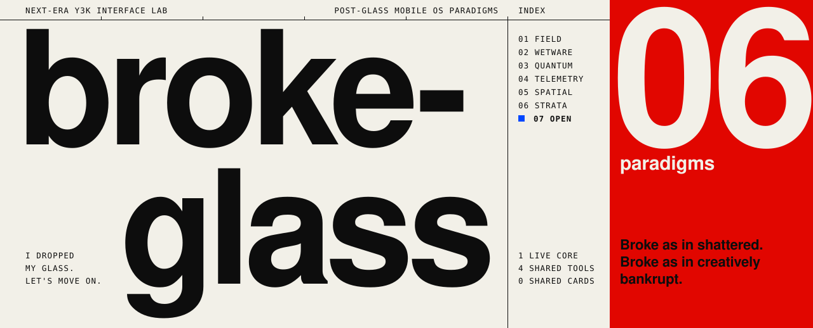
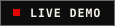
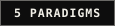
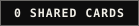
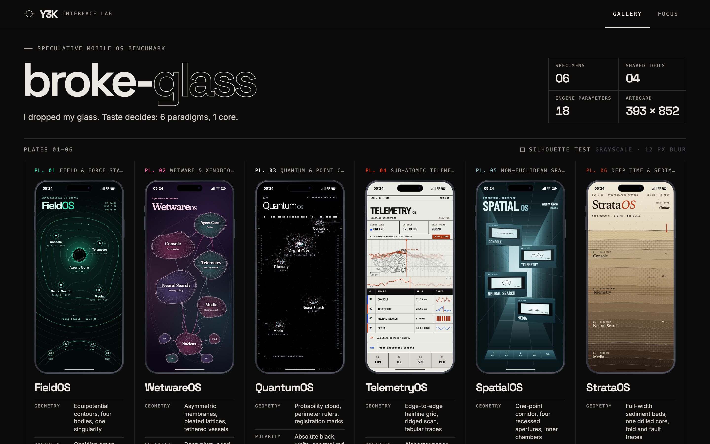
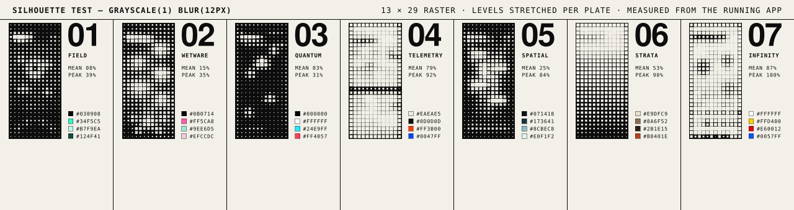
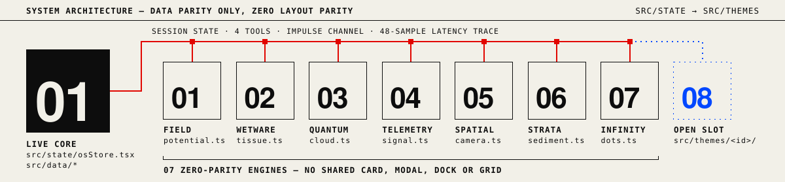

<p align="center">
  <picture>
    <source media="(prefers-color-scheme: dark)" srcset="docs/readme-hero-dark.svg">
    
  </picture>
</p>

<p align="center"><strong>Broke as in shattered. Broke as in creatively bankrupt.</strong></p>

<p align="center">
  <a href="https://aiyufan3.github.io/broke-glass/"></a>
  
  
  <a href="LICENSE"></a>
</p>

## Why we broke the glass

I dropped my glass. Let's move on.

Mobile OS design is broke. It has lived paycheck to paycheck off Frutiger Aero's 2007 homework, and the latest loan is called Liquid Glass. Same gloss, heavier GPU tax. Under it sits a fifteen-year-old grid held together with duct tape, Bento cards and the purple-to-cyan gradient every model reaches for. Slop with rounded corners. That is not bespoke. That is broke.

So this repo keeps one core and throws out the layout. Six mobile operating systems, one session state, zero shared cards. Subjective human taste is the absolute truth here. Never let a machine decide what looks right. A model optimizes for the statistical average, and the average is boring. Tools execute. Taste decides.

<p align="center">
  <a href="https://aiyufan3.github.io/broke-glass/"></a>
</p>

## Specimen sheet

<p align="center">
  <picture>
    <source media="(prefers-color-scheme: dark)" srcset="docs/paradigm-silhouettes-dark.svg">
    
  </picture>
</p>

Six home screens under `grayscale(1) blur(12px)`, measured from the running app and printed as a halftone. Blur it, drain the color, and see if it is still itself. A plate that could be mistaken for its neighbour is a theme. Themes are not accepted.

| Paradigm | Design lineage | Spatial geometry | Color polarity | Navigation | Explicitly banned |
| --- | --- | --- | --- | --- | --- |
| **01&nbsp;FieldOS** | Bret Victor · Territory Studio · potential theory | Equipotential contours, four bodies, one singularity | Obsidian green, mint line, no fills | Probe, drag, condense, return along the arc | Rectangular containers · Flat tab bars |
| **02&nbsp;WetwareOS** | Neri Oxman · Iris van Herpen · Ernst Haeckel | Asymmetric membranes, pleated lattices, tethered vessels | Deep plum, pearl linework, coral and aqua signal | Signal a cell, differentiate, rejoin at the nucleus | 90° corners · Glossy plastic highlights |
| **03&nbsp;QuantumOS** | Ryoji Ikeda · John Maeda · quantum measurement | Probability cloud, perimeter rulers, registration marks | Absolute black, white, spectral red and cyan | Observe a coordinate, type at the cursor, release | Filled cards · Solid panel borders |
| **04&nbsp;TelemetryOS** | Teenage Engineering · Dieter Rams · SEM instrumentation | Edge-to-edge hairline grid, ridged scan, tabular traces | Alabaster paper, carbon ink, thermal orange and blue | Select a row or key, inspect, close the bay | Dark Bento · Floating dock |
| **05&nbsp;SpatialOS** | James Turrell · Tadao Ando · Monument Valley | One-point corridor, four recessed apertures, inner chambers | Petrol concrete, aqua light, amber under load | Tilt, enter through an aperture, exit along Z | Flat stacks · Opaque metal plates |
| **06&nbsp;StrataOS** | Robert Smithson · Hiroshi Sugimoto · stratigraphic core logs | Full-width sediment beds, one drilled core, fold and fault traces | Sand above, umber below, one oxide-red core | Drill to a formation, excavate it, backfill to the surface | Floating panels · Radial menus |

## System architecture

<p align="center">
  <picture>
    <source media="(prefers-color-scheme: dark)" srcset="docs/architecture-dark.svg">
    
  </picture>
</p>

One store, six engines, nothing in between. A paradigm imports `src/state`, `src/data` and its own folder. There is no shared card, modal, dock or grid, so there is nothing to converge on. Each engine is a physical model stepped by pure functions and drawn to a canvas. StrataOS, plate 06, was contributed through the contract below without touching the chrome. Slot 07 is open.

## Lab controls

The lab inside is called Next-Era Y3K. Open it and pick a plate.

| Control | What it does |
| --- | --- |
| **Cross-paradigm sync** | Console, Telemetry, Neural Search and Media exist in all six, each in its own geometry. Run `spike` in one console, switch paradigm, and the same timestamped event is in the log while that engine takes the load. Also: `help` `status` `scan` `clear`. |
| **Design DNA** | Three live sliders per paradigm. Each one changes what the engine draws. The release suite fails if one stops. Settings survive a reload. |
| **Copy Paradigm Prompt** | Copies the paradigm's grammar, palette and current slider values as a prompt. |
| **Native fullscreen** | Edge to edge, uniformly scaled, desktop and phone. On a phone the gallery puts it one tap away. |
| **Silhouette test** | A switch in the gallery. Applies the blur to all six plates at once. |
| **Keys** | <kbd>1</kbd>–<kbd>6</kbd> switch paradigm · <kbd>⌘K</kbd> / <kbd>Ctrl K</kbd> console · <kbd>↑</kbd> <kbd>↓</kbd> command history · <kbd>Esc</kbd> close the tool, then fullscreen, then back to the gallery |

<details>
<summary><strong>Contribute Paradigm #07</strong></summary>

<br>

A paradigm is one folder and two registry entries. The showcase chrome is not edited.

**File contract**

```text
src/data/paradigms.ts     one ParadigmSpec entry: metadata, grammar, 3 controls, tokens
src/themes/<id>/
  <model>.ts              pure state: create, step, settle
  renderer.ts             stateless canvas painter
  <Name>OS.tsx            default export, props { interactive: boolean }
  <Tools>.tsx             the four tools, in your geometry
  <id>.css                every selector prefixed, tokens on the root element
src/themes/index.ts       one line in `surfaces`
```

`surfaces` is typed `Record<ParadigmId, …>`. The build fails until every registered specification has a surface. Gallery order, the switcher, the fullscreen selector and the number keys follow the registry.

**Rules**

1. Import `src/data/*`, `src/state/*` and your own folder. Nothing from another theme. Nothing from `src/components`. `npm run check:boundaries` enforces this with dependency-cruiser (`.dependency-cruiser.cjs`); `tests/unit/contract.test.ts` fails any selector or `@keyframes` in your CSS that does not start from a class prefixed with your id or an abbreviation of it (`tel-` for `telemetry`), any CSS `@import`, and any `import.meta.glob` or `new URL(…, import.meta.url)` that reaches outside your folder.
2. Fill the 377 × 836 surface. The status bar is drawn over the top 44 px and the home indicator over the bottom 12 px.
3. Drive the engine with `useFrameLoop(host, interactive, draw)`. A frame with `still: true` must render the settled state: it is issued for gallery plates, hidden tabs, off-screen hosts and `prefers-reduced-motion`.
4. Read state with `useOS(selector, interactive)` and, inside a frame loop, `useOSSnapshot(interactive)`. Select the smallest slice. With `interactive` false neither subscribes.
5. `state.impulse` increments on every command, scan, spike and inspection. Give it a physical response.
6. Three controls. Each must change the settled frame or start a visible response.
7. Console, Telemetry, Neural Search and Media, with these accessible names:

| Tool | Names the release suite uses |
| --- | --- |
| Console | log `Console logs` · textbox `Console command` with `data-os-command` · buttons `help` `scan` `spike` `status` `clear` |
| Telemetry | buttons `Core` `Field` `Link` `Audio` · a stress toggle |
| Neural Search | textbox `Search nodes` · result buttons with `aria-expanded` · an action that calls `inspectNode` |
| Media | slider `Playback position` · buttons `Play` `Pause` `Previous track` `Next track` `Sound` |

**The silhouette rule**

Under `grayscale(1) blur(12px)` the home screen must be identifiable by its distribution of mass alone, beside the other six. Turn on **Silhouette test** in the gallery, then print the plate:

```sh
npm run silhouettes   # measure every registered plate from the running app
npm run posters       # redraw the specimen sheet, the diagram and the posters
```

If the new column reads as one of the existing six, it is not a new paradigm.

**Gates**

1. Add the three controls to `all eighteen engine controls change what their engine draws` (and update the count), and the new launcher to the console and search loops, in `tests/release.spec.mjs`.
2. Add at least one invariant of the model to `tests/unit/physics.test.ts`. `tests/unit/registry.test.ts` checks the specification itself. Every `src/themes/*/*.ts` model file must keep 90 % line, statement and function coverage and 75 % branch coverage on its own; an engine without tests fails the gate.
3. Measure your plate with `npm run silhouettes` and commit `scripts/silhouettes.json`: `tests/unit/silhouette.test.ts` fails any two plates nearer than the floor in its header. Add your canvas to `engines` in `tests/settled.spec.mjs` and record it once with `UPDATE_BASELINES=1 npx playwright test tests/settled.spec.mjs`; every settled frame is then compared with `tests/baselines/settled-samples.json`. Re-record an existing engine only for an intended change to its renderer.
4. `npm run typecheck && npm run build && npm test`. No errors. No warnings. `npm test` runs the import boundaries, the unit suite and the browser suite. CI runs the same gates before anything is deployed.

</details>

<details>
<summary><strong>What each engine computes</strong></summary>

<br>

| Paradigm | Model | Module | Try |
| --- | --- | --- | --- |
| FieldOS | Scalar potential of one singularity, four softened point masses and a pointer probe, contoured by marching squares. Bodies are damped springs with short-range repulsion. Opening a tool sends two wave fronts whose crossings are drawn. | `field/potential.ts` | Set Gravity Warp to 0. Every contour becomes a circle. |
| WetwareOS | Membranes are low-order harmonics around an ellipse. Vessels are cubic curves from hilum to hilum, so they stay on both membranes while cells migrate on under-damped springs. Pulses dilate the vessel wall. | `wetware/tissue.ts` | Move Synapse Speed. Each change fires a pulse from the nucleus. |
| QuantumOS | Up to 4,200 seeded samples, each blended between two states. Observation moves a coordinate's samples onto bracket marks. Tools re-form the cloud: a barcode of the last command, the latency trace, a standing wave, one cluster per search node. | `quantum/cloud.ts` | Hover a coordinate. A cyan reticle runs out to the rulers. |
| TelemetryOS | A relief function of position, depth and pass number. The beam re-acquires the specimen on every pass. The oscilloscope plots the selected depth line and a peak finder tracks its maximum. | `telemetry/signal.ts` | Switch channel. Scan band, trace, peak marker and SEM number follow. |
| SpatialOS | A camera that reproduces the CSS transform order, so the canvas corridor and the DOM slabs share one projection. A dive aligns the camera with an aperture, then pushes through it into a lit room. | `spatial/camera.ts` | Select an aperture. The camera goes through it. |
| StrataOS | Bed boundaries laid down by deposition, thinned by compaction and bent by a fold. Every deformation is a map of depth onto depth with slope below one, so no horizon can cross another. Excavating a formation lifts the overburden and presses the beds below toward bedrock with one shared time constant. | `strata/sediment.ts` | Run `spike`. The block beyond the fault drops and the column keeps trembling. |

All six draw to Canvas 2D. SpatialOS adds CSS 3D for its slabs. Readouts describe a local simulation. Design DNA settings are saved to `localStorage` under a versioned key (`src/state/persist.ts`) and restored on reload; a value that fails validation falls back to its default. Logs, tools, telemetry and media live in memory until reload, and gallery plates always show the defaults.

</details>

<details>
<summary><strong>Local dev / GitHub Pages deploy</strong></summary>

<br>

Node **20.19+** or **22.12+** to build. The test toolchain (Vitest 5) needs **22.12+**.

```sh
npm install
npm run dev
```

```sh
npm run typecheck   # strict TypeScript, no unused locals or parameters
npm run build       # typecheck, then a production bundle in dist/
npm run preview     # serve dist/
```

```sh
npx playwright install chromium
npm test            # check:boundaries, test:unit, then test:e2e
npm run check:boundaries   # dependency-cruiser: paradigm, core and chrome import rules
npm run test:unit   # Vitest: engine invariants and registry, with model coverage in coverage.local/
npm run test:e2e    # Playwright: the browser release suite, settled-frame samples and the README checks
npm run check:bundle   # after a build: dist/ and its largest script against their byte budgets
npm run test:perf   # after a build: long tasks in the gallery and frame times in focus, on the production bundle
```

Every performance budget is in `tests/perf-budgets.mjs`, with the measurement it was set from.

Set `PLAYWRIGHT_CHANNEL=chrome` to use an installed Chrome. Set `SHOWCASE_URL` to a deployed URL, including the repository subpath and trailing slash, to run the browser suite against it.

**Posters and screens**

Every graphic on this page is generated. Nothing is drawn by hand and nothing is fetched.

```sh
npm run silhouettes   # scripts/silhouettes.json: luminance of each plate under the blur
npm run posters       # docs/*.svg and public/og-preview.svg, light and dark
npm run og            # posters, then public/og-preview.png rasterized from the SVG
npm run screens -- <dir>   # 2× PNGs: gallery, six focus views, mobile, each paradigm at rest and under load
```

The README gallery is `00-gallery-overview@2x.png` from `npm run screens`. The social tags point at the PNG. Crawlers do not render SVG.

**Deploy**

1. In **Settings → Pages → Build and deployment**, select **GitHub Actions**.
2. Push to `main`, or run the **GitHub Pages** workflow. It installs the locked dependencies, then typechecks, checks the import boundaries, runs the unit tests with the coverage floor, builds and checks the bundle size budget, installs Chromium, runs the browser release suite twice, on the dev server and on the production bundle (`PLAYWRIGHT_PREVIEW=1`), and then the performance budgets. Only when every gate passes does it build `dist/` for Pages and deploy it. Pull requests run the gates without deploying.
3. The workflow passes the Pages URL to the build as `VITE_SITE_URL`, which makes the social image URL absolute and adds `og:url`. For a manual build, set `VITE_SITE_URL=https://<account>.github.io/broke-glass/`.

Assets use a relative base and routes are hashes, so project subpaths and links such as `/#quantum` work without configuration. Fonts ship with the bundle.

</details>

## License

[MIT](LICENSE). Notices for bundled libraries, icons and fonts are in [`public/third-party-licenses.txt`](public/third-party-licenses.txt).
